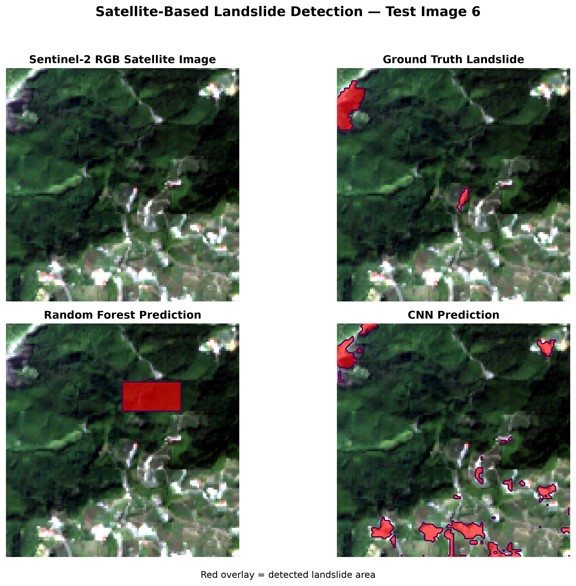
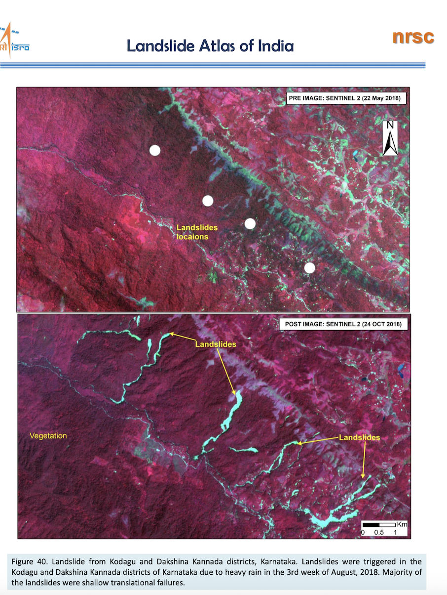
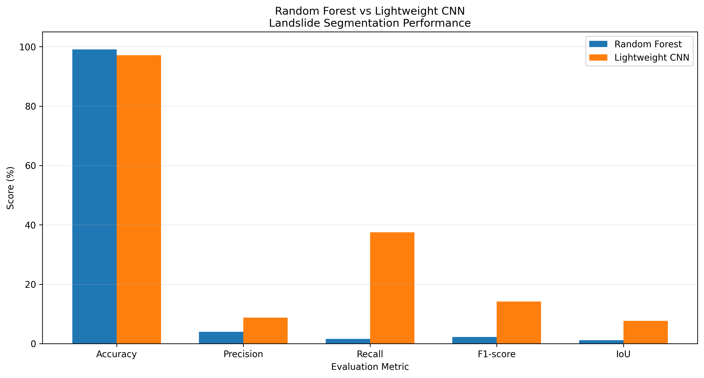

# Machine Learning and Deep Learning Based Landslide Detection Using Satellite Imagery

## 📌 Project Overview

Landslides are natural hazards that can cause significant damage to infrastructure, roads, settlements, and natural resources, particularly in mountainous and hilly regions. Timely identification and mapping of landslide-affected areas using satellite imagery can support disaster assessment, hazard monitoring, and emergency response.

This project develops a **Machine Learning and Deep Learning based system for identifying and delineating landslide-affected areas from satellite imagery**. Two approaches were implemented and compared:

- **Random Forest** as the baseline Machine Learning model
- **Lightweight Convolutional Neural Network (CNN)** as the Deep Learning model

The models were evaluated using Accuracy, Precision, Recall, F1-score, and Intersection over Union (IoU), followed by visualization of detected landslide regions and approximate landslide-area estimation.

---

## 🎯 Objective

The main objectives of this project are:

- Identify landslide-affected areas from satellite imagery.
- Extract relevant spectral features and indices.
- Develop a baseline Machine Learning model using Random Forest.
- Develop a lightweight CNN-based segmentation model.
- Compare Machine Learning and Deep Learning approaches.
- Evaluate model performance using standard classification and segmentation metrics.
- Visualize the predicted landslide-affected regions.
- Estimate the approximate area affected by landslides.

---

## 🗺️ Study Area

**Kodagu (Coorg), Karnataka, India**

Kodagu is a mountainous and hilly region of Karnataka that experiences landslide activity, particularly during periods of heavy rainfall. The region was selected as the study area for demonstrating satellite-based landslide detection and mapping.

---

## 📊 Dataset

The project uses the publicly available **Landslide4Sense** dataset for landslide detection and segmentation.

The dataset provides multispectral satellite imagery along with corresponding ground-truth landslide masks.

The input imagery contains multiple spectral bands, from which relevant features were extracted for the Machine Learning and Deep Learning models.

### Dataset Components

- Multispectral satellite imagery
- Ground-truth landslide masks
- Landslide and non-landslide pixels
- Image patches for CNN-based processing

> The original dataset is not included in this repository due to its size and dataset distribution considerations.

---

## 🛰️ Spectral Features

The following spectral features were used for the analysis:

| Feature | Description |
|---|---|
| Blue | Blue spectral band |
| Green | Green spectral band |
| Red | Red spectral band |
| NIR | Near Infrared band |
| NDVI | Normalized Difference Vegetation Index |
| NDWI | Normalized Difference Water Index |

These features provide spectral information that can help distinguish landslide-affected surfaces from surrounding vegetation and other land-cover types.

---

# 🏗️ Workflow Architecture


              Satellite Imagery
                     +
             Landslide Ground Truth
                     |
                     v
              Data Preprocessing
                     |
                     v
          Spectral Feature Extraction
                     |
             +-------+-------+
             |               |
             v               v
       Random Forest      Lightweight CNN
       (ML Baseline)     (Deep Learning)
             |               |
             v               v
       Pixel Prediction   Pixel Segmentation
             |               |
             +-------+-------+
                     |
                     v
             Model Evaluation
                     |
                     v
     Accuracy / Precision / Recall
          F1-score / IoU
                     |
                     v
          Landslide Visualization
                     |
                     v
        Approximate Area Estimation
        # 🤖 Machine Learning Approach

## Random Forest

Random Forest was implemented as the baseline Machine Learning approach for landslide detection.

The model uses the extracted spectral features from the satellite imagery to perform pixel-level classification.

### Input Features

The following six features were used:

- **Blue** – Blue spectral band
- **Green** – Green spectral band
- **Red** – Red spectral band
- **NIR** – Near Infrared spectral band
- **NDVI** – Normalized Difference Vegetation Index
- **NDWI** – Normalized Difference Water Index

Each pixel is represented using these spectral features and classified into two classes:

```text
0 → Non-Landslide
1 → Landslide
```

### Random Forest Workflow

```text
Satellite Image
       ↓
Spectral Feature Extraction
       ↓
Blue, Green, Red, NIR
NDVI, NDWI
       ↓
Pixel Feature Matrix
       ↓
Random Forest Classifier
       ↓
Pixel-Level Prediction
       ↓
Landslide Prediction Map
```

### Implementation

The Random Forest implementation is available in:

```text
src/random_forest.py
```

The complete multi-image processing pipeline is available in:

```text
multi_image_pipeline.py
```

The trained Random Forest model is stored in:

```text
outputs/models/random_forest_landslide.pkl
```

The generated Random Forest predictions are stored in:

```text
outputs/predictions/rf_test_predictions.npy
```

---

# 🧠 Deep Learning Approach

## Lightweight CNN

A lightweight Convolutional Neural Network (CNN) was implemented to perform landslide segmentation from satellite imagery.

Unlike a conventional image-level classifier, the CNN is designed to identify the spatial location of landslide pixels within the input image.

### CNN Input

The CNN uses multispectral image patches containing the following six features:

```text
Blue
Green
Red
NIR
NDVI
NDWI
```

The image data is divided into smaller patches before being provided to the CNN.

### CNN Workflow

```text
Multispectral Satellite Image
            ↓
      Feature Extraction
            ↓
      Image Normalization
            ↓
       Image Patching
            ↓
   Lightweight CNN Model
            ↓
   Pixel-Level Prediction
            ↓
    Landslide Segmentation
            ↓
      Prediction Mask
```

### Model Characteristics

The implemented CNN is intentionally lightweight so that it can be trained and evaluated with limited computational resources.

The model contains approximately **10,161 trainable parameters**.

The CNN implementation is available in:

```text
src/cnn.py
```

The multi-image CNN pipeline is available in:

```text
multi_image_cnn.py
```

The trained CNN model is stored in:

```text
outputs/models/cnn_landslide.keras
```

The CNN prediction outputs are stored in:

```text
outputs/predictions/
```

---

# 📈 Model Evaluation

The Random Forest and CNN models were evaluated using standard classification and segmentation metrics.

The following metrics were calculated:

- **Accuracy**
- **Precision**
- **Recall**
- **F1-score**
- **Intersection over Union (IoU)**

## Evaluation Metrics

### Accuracy

Accuracy represents the proportion of correctly classified pixels among all evaluated pixels.

```text
Accuracy = Correct Predictions / Total Predictions
```

### Precision

Precision measures how many pixels predicted as landslide were actually landslide pixels.

```text
Precision = TP / (TP + FP)
```

### Recall

Recall measures how many of the actual landslide pixels were correctly detected.

```text
Recall = TP / (TP + FN)
```

### F1-score

F1-score provides a balance between Precision and Recall.

```text
F1 = 2 × (Precision × Recall) /
     (Precision + Recall)
```

### Intersection over Union (IoU)

IoU measures the overlap between the predicted landslide region and the ground-truth landslide region.

```text
IoU = Intersection / Union
```

---

# 📊 Results and Discussion

The models were evaluated on the test data and their predictions were compared with the corresponding ground-truth landslide masks.

## Random Forest Results

| Metric | Random Forest |
|---|---:|
| Accuracy | 98.05% |
| Precision | 60.24% |
| Recall | 61.73% |
| F1-score | 60.98% |
| IoU | 43.86% |

## Lightweight CNN Results

| Metric | Lightweight CNN |
|---|---:|
| Accuracy | 92.63% |
| Precision | 19.75% |
| Recall | 55.36% |
| F1-score | 29.11% |
| IoU | 17.03% |

## Model Comparison

| Metric | Random Forest | Lightweight CNN |
|---|---:|---:|
| Accuracy | **98.05%** | 92.63% |
| Precision | **60.24%** | 19.75% |
| Recall | **61.73%** | 55.36% |
| F1-score | **60.98%** | 29.11% |
| IoU | **43.86%** | 17.03% |

Based on the evaluated test data, the **Random Forest model outperformed the lightweight CNN across all reported metrics**.

The Random Forest achieved an Accuracy of 98.05% and an IoU of 43.86%, while the CNN achieved an Accuracy of 92.63% and an IoU of 17.03%.

The CNN was able to detect a considerable portion of the actual landslide pixels, as reflected by its Recall of 55.36%. However, its lower Precision of 19.75% indicates a relatively high number of false-positive predictions.

One important factor affecting CNN performance is the limited number of training patches available for the experiment. The lightweight architecture was also designed with a small number of parameters to reduce computational requirements.

Future experiments using a larger and more diverse training dataset, stronger data augmentation, hyperparameter tuning, and advanced segmentation architectures could potentially improve the CNN results.

---

# 🗺️ Landslide Visualization

The model predictions were converted into spatial landslide maps for visual interpretation.

The generated visualization results are available in:

```text
outputs/visualizations/
```

Important outputs include:

```text
IIRS_Landslide_Detection_Result.png
Landslide_area_Kodagu.png
Study_Area_Kodagu_karnataka.png
kodagu_study_area.png
model_performance_comparison.png
```

### Landslide Detection Result



### Landslide Area



### Model Performance Comparison



---

# 📐 Landslide Area Estimation

The predicted landslide mask was also used to estimate the approximate area affected by landslides.

The area estimation follows the relationship:


Landslide Area =
Number of Landslide Pixels × Area Represented by One Pixel


The predicted landslide coverage was compared with the ground-truth coverage to assess how closely the models delineated the actual affected region.

For the evaluated CNN result:

```text
Ground-Truth Landslide Coverage ≈ 2.47%

CNN Predicted Landslide Coverage ≈ 5.23%
```

This indicates that the CNN predicted a larger landslide region than the ground truth, which is consistent with its relatively low Precision and IoU.

The area-estimation visualization is available at:

outputs/visualizations/Landslide_area_Kodagu.png


---

# 📁 Output Files

The `outputs/` directory contains the trained models, prediction results, performance figures, and visualization maps.

```text
outputs/
│
├── archive/
│   └── cnn_landslide_model.keras
│
├── figures/
│   ├── landslide_comparison.png
│   └── rf_comparison.png
│
├── models/
│   ├── cnn_landslide.keras
│   └── random_forest_landslide.pkl
│
├── predictions/
│   ├── cnn_test_predictions.npy
│   ├── cnn_test_probabilities.npy
│   └── rf_test_predictions.npy
│
└── visualizations/
    ├── IIRS_Landslide_Detection_Result.png
    ├── Landslide_area_Kodagu.png
    ├── Study_Area_Kodagu_karnataka.png
    ├── kodagu_study_area.png
    └── model_performance_comparison.png
```
# 📁 Project Structure

```text
landslide-detection/
│
├── README.md
├── requirements.txt
│
├── main.py
├── multi_image_pipeline.py
├── multi_image_cnn.py
├── compare_models.py
├── download_subset.py
├── study_area.py
├── performance_chart.py
├── visualize_results.py
│
├── notebooks/
│   └── landslide_detection.ipynb
│
├── src/
│   ├── preprocessing.py
│   ├── features.py
│   ├── random_forest.py
│   ├── cnn.py
│   ├── evaluation.py
│   └── visualization.py
│
└── outputs/
    ├── archive/
    ├── figures/
    ├── models/
    ├── predictions/
    └── visualizations/
# ⚙️ Technologies Used

- **Python** – Core programming language
- **NumPy** – Numerical and array-based data processing
- **Scikit-learn** – Random Forest Machine Learning implementation
- **TensorFlow / Keras** – Lightweight CNN implementation
- **Matplotlib** – Data visualization and performance analysis
- **Pillow** – Image processing
- **h5py** – Handling HDF5-based satellite data
- **Joblib** – Saving and loading the trained Random Forest model
- **Jupyter Notebook** – Exploratory analysis and experimentation

---

# 🚀 Installation and Setup

## 1. Clone the Repository

```bash
git clone https://github.com/Ankanpandey28/landslide-detection.git
cd landslide-detection
2. Create a Virtual Environment
python3 -m venv venv
3. Activate the Virtual Environment
macOS / Linux
source venv/bin/activate
Windows
venv\Scripts\activate
4. Install Required Dependencies
pip install -r requirements.txt
5. Dataset Setup
The original Landslide4Sense dataset is not included in this repository.
Download the required dataset separately and place the dataset files inside:
data/
The data/ directory is excluded from GitHub using .gitignore.
6. Run the Project
The main project scripts include:
python main.py
python multi_image_pipeline.py
python multi_image_cnn.py
python compare_models.py
python visualize_results.py
python study_area.py
python performance_chart.py
🔬 Key Outcomes
The project demonstrates the application of Machine Learning and Deep Learning techniques for satellite-image-based landslide detection and segmentation.
The major outcomes include:
Extraction of multispectral satellite-image features.
Utilization of Blue, Green, Red, and NIR spectral bands.
Calculation and utilization of NDVI and NDWI.
Development of a Random Forest based baseline Machine Learning model.
Implementation of a lightweight CNN-based Deep Learning model.
Pixel-level landslide detection and segmentation.
Quantitative comparison between Random Forest and CNN approaches.
Evaluation using Accuracy, Precision, Recall, F1-score, and IoU.
Generation of landslide prediction masks.
Visualization of landslide-affected regions.
Visualization of the selected Kodagu study area.
Approximate estimation of landslide-affected area.
Generation of model performance comparison plots.
📌 Limitations
The current implementation has the following limitations:
The CNN was trained using a relatively small number of image patches.
The lightweight CNN architecture has limited representational capacity compared with larger segmentation networks.
The study uses a limited dataset subset and study region.
Model performance may vary across different geographical regions and environmental conditions.
Spectral information alone may not capture all terrain characteristics associated with landslides.
The current system has not been extensively validated on independent geographical regions.
The generated predictions are experimental and require further validation before operational use.
🔮 Future Improvements
The following improvements can be explored in future work:
Increase the size and diversity of the training dataset.
Apply stronger data augmentation techniques for CNN training.
Perform systematic hyperparameter optimization for the Random Forest model.
Compare Random Forest with other Machine Learning algorithms such as SVM.
Implement advanced segmentation architectures such as U-Net.
Incorporate Digital Elevation Model (DEM) data.
Include terrain features such as slope, elevation, and aspect.
Incorporate additional spectral indices and satellite-derived features.
Test the models on additional landslide-prone regions of India.
Perform cross-region validation to evaluate model generalization.
Develop a web-based interface for landslide detection and visualization.
Integrate near-real-time satellite imagery for future landslide monitoring.
Improve landslide-area estimation using accurate geospatial resolution and coordinate information.
👥 Team
This project was developed as a two-member team as part of the virtual training program.
Bharti Sahu
Branch: Artificial Intelligence
Course: B.Tech
Ankan Pandey
Branch: Information Technology
Course: B.Tech
🏫 Training Program
This project was developed as part of the:
Virtual Training on Geoprocessing and Data Analysis
Indian Institute of Remote Sensing (IIRS)
Indian Space Research Organisation (ISRO)
Dehradun, Uttarakhand, India
📚 Academic Context
The project was developed in response to the following problem statement:
Develop a Machine Learning/Deep Learning-based system to identify landslide-affected areas from satellite images of a selected mountainous or hilly region.
The project follows the major stages suggested in the problem statement:
Selection of a mountainous/hilly study region.
Use of publicly available labeled satellite imagery.
Extraction of relevant spectral features and indices.
Development of a baseline Machine Learning model using Random Forest.
Implementation of a lightweight CNN-based Deep Learning model.
Comparison of Machine Learning and Deep Learning approaches.
Evaluation using Accuracy, Precision, Recall, F1-score, and IoU.
Visualization of identified landslide-affected regions.
Estimation of approximate landslide-affected area.
 Disclaimer
This project has been developed for academic and educational purposes as part of virtual training.
The generated landslide prediction maps and estimated affected areas are experimental and should not be considered a substitute for detailed geological surveys, field verification, remote-sensing analysis by experts, or official disaster-management assessments.
Model performance may vary depending on geographical location, satellite imagery, environmental conditions, and dataset characteristics.
 Acknowledgement
We would like to express our sincere gratitude to the Indian Institute of Remote Sensing (IIRS), ISRO, Dehradun for providing the virtual training framework, technical guidance, and problem statement for this project.
We also acknowledge the creators and contributors of the Landslide4Sense dataset for providing publicly available labeled landslide data that supports research and educational work in satellite-image-based landslide detection and segmentation.
We are grateful for the opportunity to apply Machine Learning, Deep Learning, Remote Sensing, and Geospatial Data Analysis techniques to a real-world environmental hazard problem.
